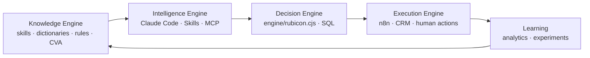
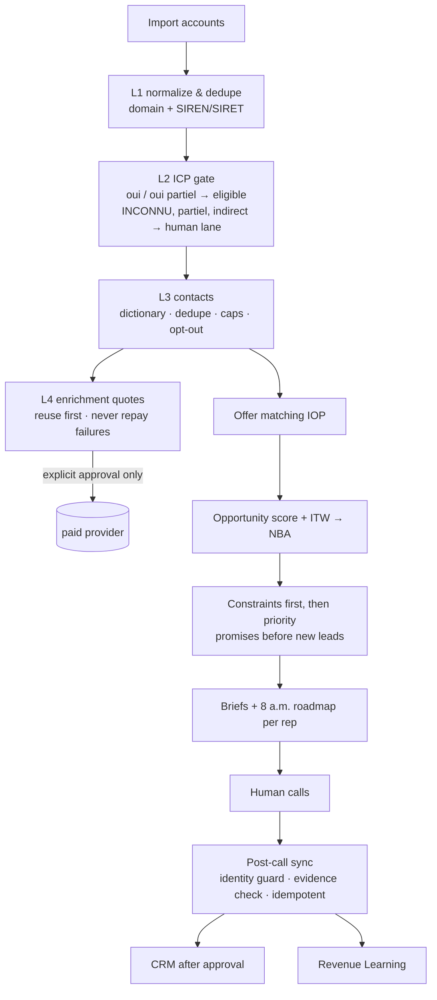

# RUBICON — GTM Engineering & Revenue Operating System

> **Stop generating leads. Start engineering revenue.**

Before you hire more salespeople, engineer the environment they sell in.

RUBICON turns company, contact, offer and sales-team data into **explainable, executable daily decisions**: who to call, why, with which offer, in which order, and by whom. It runs on synthetic data with no paid API, and the same decision engine powers the CLI, the Claude Code skills and the n8n workflows.

**Status: open-source portfolio prototype (v1.0.0).** It is not a SaaS, a dialer, a scraper or a validated prediction model. All demo data is fictional. No performance has been measured for RUBICON.

---

## The business problem

Companies build an *Ideal Customer Profile* for their buyers, but rarely an ideal profile for **their own reps**, **their offers** or **their timing**. The usual result:

- leads get bought before anyone checks whether the companies fit;
- the right prospect is called by the wrong rep with the wrong offer;
- promised follow-ups get buried under fresh, better-scored leads;
- reps spend their first hour working out who to call.

RUBICON treats sales performance as an engineering problem of **qualification, matching, allocation and learning**.

## Method: six steps

| Step | What RUBICON does | Where |
|---|---|---|
| **DISCOVER** | Market mapping, sources, signals | `market-intelligence` skill (documented) |
| **UNDERSTAND** | Company-first qualification (ICP verdicts), buyer roles, title dictionaries | engine L1–L3, `icp-builder`, `outbound-setup` |
| **MATCH** | Offer × account × contact (IOP), rep × action (ISP), timing (ITW) | engine `matchOffers`, `allocate` |
| **ACTIVATE** | Cost-gated enrichment, Next Best Action, call briefs, 8 a.m. roadmap, CRM sync | engine L4, NBA, `dailyRoadmap`, `postCallSync` |
| **EXPAND** | Cross-sell suggestions, reactivation of dormant contacts | NBA `propose_offer`, `reactivate` |
| **LEARN** | SQL funnel with explicit denominators, experiments instead of silent rule changes | `analytics/`, `sql/kpis.sql` |

Working vocabulary (RUBICON's own nomenclature, **not industry standards**): **ICP** Ideal Customer Profile · **BP** Buyer Persona · **ISP** Ideal Sales Profile · **IOP** Ideal Offer Profile · **ITW** Ideal Timing Window · **NBA** Next Best Action · **CVA** Commercial Value Asset (a real study, audit or benchmark that gives a legitimate reason to call).

## Architecture





**One decision engine, three interfaces.** `engine/rubicon.cjs` is pure JavaScript with no dependency and no I/O. The CLI imports it, `engine/build-workflows.cjs` embeds it in n8n Code nodes, and the skills call the CLI. Python + SQLite handle analytics only, so there are never two scoring engines drifting apart.

## Stack

Claude Code · Claude Skills · MCP · n8n · JavaScript (Node ≥ 20) · Python 3 (stdlib) · SQL / SQLite · JSON · Markdown · CSV-ready exports. No npm or pip dependency.

## Quick start (no account, no credentials, no spend)

```bash
git clone <this repo> && cd rubicon-gtm-engine
./install.sh                 # checks Node/Python, runs every test, builds the demo
npm run demo                 # daily roadmap + call briefs → outputs/demo/
npm run postcall             # post-call sync preview → outputs/demo/postcall-output.json
npm run analytics            # SQL KPIs on simulated outcomes → outputs/analytics/kpi-report.md
```

Open `outputs/demo/daily-roadmap.md`. Excerpt from the real demo output (labels translated from French):

| Time | Block | Action | Contact | Company | Why |
|---|---|---|---|---|---|
| 08:00 | 1 · Promised follow-ups | followup_email | Victor Faure | Bureaux Quai Ouest | promised on 2026-11-18 at 16:00 · P 88.52 |
| 08:10 | 2 · Meeting prep | prepare_meeting | Eva Lambert | Galerie Marée | O 65.12 · M 85 · P 61.32 |
| 09:00 | 3 · Prospecting block 1 | call | Noé Bernard | Galerie Marée | O 65.12 · M 82.75 · P 64.32 |

…plus a **manager escalation**: a follow-up promised for today whose owner lacks the required offer expertise. The engine refuses to drop the promise or to reassign it silently.

### n8n

Import `workflows/rubicon-daily.n8n.json` (13 nodes) and `workflows/rubicon-postcall.n8n.json` (5 nodes), then click *Execute*. Each stage is its own node, so you can inspect qualification, quotes, matching and allocation step by step. The workflows have no credential and no HTTP node, and they are inactive.
**Verified:** both workflows were imported and executed with **n8n 1.123.99** via `n8n execute`, and the daily output is byte-identical to the CLI (`outputs/n8n/EXECUTION_PROOF.md`). n8n 2.x requires Node 24 and has not been tested yet.

## Claude Skills (`.claude/skills/`, project-local)

| Skill | Status | Role |
|---|---|---|
| `outbound-setup` | implemented | Builds *your* workspace: context, offers (IOP), vertical, title dictionary, reps (ISP), tools, file, CRM, script |
| `outbound-batch` | implemented | Qualify before paying: batch, review gates, quotes, approval |
| `post-call-sync` | implemented | Notes → statuses, identity guard, evidence check, idempotent CRM proposals |
| `offer-matching` | implemented | Explainable offer fit, guarded cross-sell |
| `sales-matching` | implemented | Constraint-first, explainable allocation, escalations |
| `daily-roadmap` | implemented | The 8 a.m. plan per rep with briefs |
| `call-preparation` | implemented (engine briefs) · live research to come | Six-block, ~25 s script, icebreaker priority, objections |
| `revenue-learning` | implemented on simulated data | Funnel, CIs, small-sample flags, experiments |
| `market-intelligence` | documented | Market mapping → verified CVA |
| `icp-builder` | documented | ICP, personas, dictionaries, exclusions |

Open the repo in Claude Code and type `/outbound-setup`.

## MCP and modes

Every external operation goes through an adapter with three modes, enforced in code (`engine/adapters.cjs`):

| Mode | Network | Spend | External writes |
|---|---|---|---|
| `mock` | none | 0 | 0, deterministic fake results |
| `dry-run` | none | 0 | 0, returns the exact plan |
| `live` | only with an approved quote/write ID **and** an implemented adapter | approved amount | approved scope |

The open-source edition deliberately ships **no live provider adapter**. See `docs/MCP_SETUP.md` for connectors (Google Sheets, Notion, Gmail, Calendar, Icypeas, Pipecorn, Allo, HubSpot…) and what must be verified against each provider's current docs.

## Formulas (configurable hypotheses, not validated results)

```
Offer Fit     = 100 × (0.50·problem_fit + 0.30·sector_fit + 0.20·persona_fit)
Opportunity   = 0.45·ICP_fit + 0.25·persona_fit + 0.30·intent_timing          (0–100)
Sales Match   = 0.55·offer_expertise + 0.30·industry_expertise + 0.15·declared_task_preference
Priority      = 0.55·Opportunity + 0.30·Sales_Match + 15·promise_due + 5·overdue + 5·goal_gap(new calls)
```

Hard constraints run **before** priority: opt-out, capacity, minimum offer expertise, complexity, language, account exclusions, relationship owner. Promised follow-ups are processed first. Missing data contributes 0 and is **flagged**, never imputed. Each score ships with its contributions, so a manager can read, contest and override it. Allocation uses a deterministic greedy heuristic, **not a global optimum**; the constrained-optimization formulation is in `docs/SCORING.md`.

### Matching example (from the demo)

Marc Dubois, owner of a fictional bakery, for the *NFC review cards* offer:
- Opportunity **62.1** = ICP 88×0.45 (39.6) + persona 90×0.25 (22.5) + intent 0 (*no verified signal, flagged*)
- Sales match (Jordan) **85.75** = offer 85×0.55 + industry 85×0.30 + declared preference 90×0.15
- Priority **64.39**, assigned to Jordan at 09:00. The full six-block script is generated because this offer has a (fictional, demo-flagged) verified asset and citable reference. Offers without one get **no** "reason to call" sentence and a warning instead.

## Data model

Workspaces · Accounts · Contacts · Offers · Sales Reps · Objectives · Campaigns · Signals · Activities · Actions · Opportunities · Meetings · Enrichment Logs: see `sql/schema.sql` (SQLite, portable to PostgreSQL) and `docs/DATA_MODEL.md`. Stable IDs everywhere, a `workspace_id` on every row, and constraints such as *never "Rappeler" with zero calls* and *no lost deal without a reason* are enforced by the database.

## Prototype results (what was actually tested)

- 25 Node tests + 5 Python tests pass (`npm test`), covering qualification lanes, cost gates, failure ledger, phone checks, explainability (scores = sum of contributions), promise handling, escalation, capacity, ISP guard, workspace separation, determinism, post-call idempotency/identity/evidence, modes, and n8n parity.
- 500 synthetic accounts are processed in about 70 ms.
- Real n8n 1.123.99 execution of both workflows.
- **Not** tested: live providers, real CRM writes, n8n 2.x, real conversion rates.

## Limits

Weights are unvalidated hypotheses. Slots don't check real calendars yet. Daylight-saving edges are approximated. The note classifier is rule-based French vocabulary. Cross-sell is suggestion-only. Simulated outcomes say nothing about real performance. Legal review (GDPR, French B2B prospecting rules, provider terms, AI Act for automated task allocation) is required before any commercial use.

## Roadmap

See `docs/ROADMAP.md`: real pilots → live adapters behind approvals → calendar-aware scheduling → CRM read/reconcile → multi-tenant platform (Next.js, PostgreSQL/Supabase).

## Sources & credits

- Methodology inspiration: **[Outbound Blueprint](https://github.com/morterolvalentin-ctrl/outbound-blueprint)** by Valentin Morterol (Scalon), MIT License. Company-first qualification, ICP verdicts, title dictionaries, human cost gates, identity guard, evidence-checked post-call sync and the Notion CRM spec come from that work (see `THIRD_PARTY_NOTICE.md`). Scalon's self-reported results are **not** RUBICON results.
- Scoring, offer/sales matching, allocation, NBA, roadmap, briefs, modes, analytics: RUBICON's own implementation.

## License

MIT, see `LICENSE`. Third-party notices: `THIRD_PARTY_NOTICE.md`.
